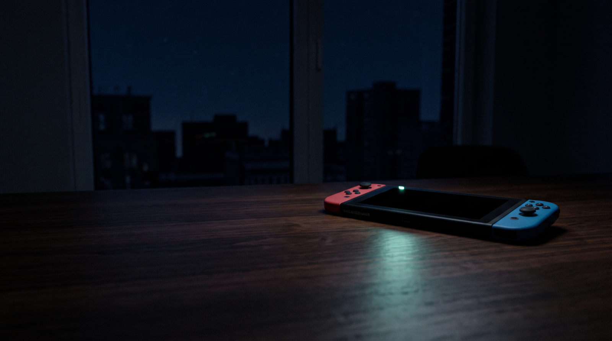
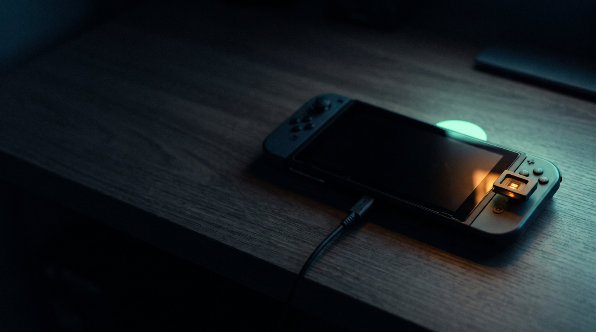
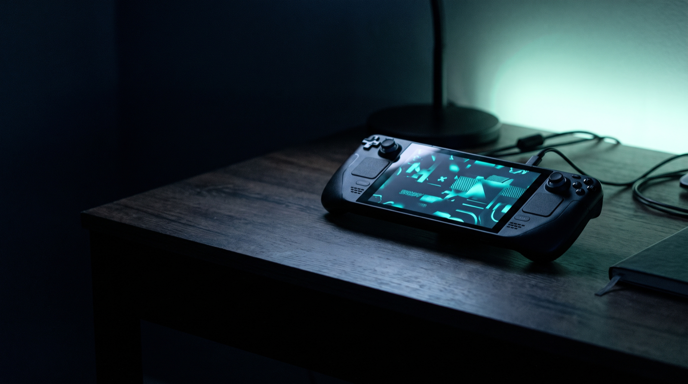
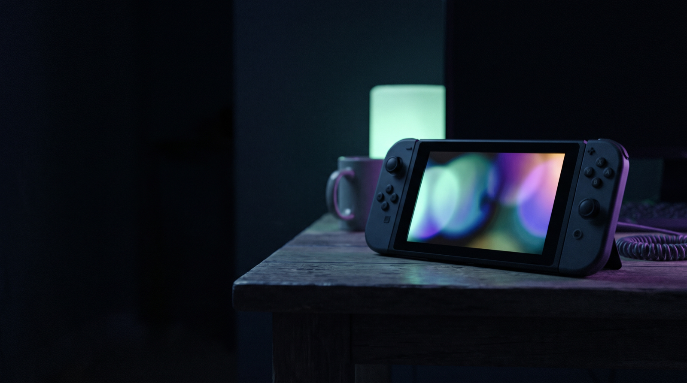

<div align="center">

# SwitchSentinel

### The gentle homebrew companion for your Nintendo Switch — from your Mac.

**Reboot into Hekate over USB-C · audit your SD card · anti-ban shield score · one-click updates · PS5/PS4/Xbox controllers · WiFi installs · custom boot & home themes.**

     

 

</div>

---

**SwitchSentinel** turns your Mac into a quiet, safe control room for a first-gen (Erista / V1, RCM-exploitable) Nintendo Switch running the **Atmosphère** CFW via **Hekate**. It is a small local app (one Python file + a web UI, zero cloud) that **reads before it writes, always backs up, and never touches anything without an explicit confirmation**.

It stays strictly inside the **homebrew / backup / comfort / security** lane — no shops, no game installers, no piracy.

## ✨ Features

- **⚡ Reboot into Hekate over USB-C (RCM).** Live USB state (RCM / Hekate / Horizon / asleep) and a one-click payload injection (Fusée Gelée) — exactly what a V1 needs after a dead battery sends it back to stock.
- **🔎 Full SD-card audit.** Reads the installed Atmosphère / Hekate / Nyx versions straight from the binaries, lists homebrew, overlays and system modules, flags macOS junk, exFAT risks, a full SD card, and more.
- **🛡️ Anti-ban shield score (0–5).** Verifiable, on-card checks: emuMMC active, Nintendo DNS blocked, PRODINFO blanked, a clean stock-sysNAND boot entry, and a complete NAND backup.
- **🔄 Safe updates.** Plans every change, **copies every replaced file (and all your `.ini` settings) to a timestamped backup first**, then writes atomically. Your configs are never overwritten.
- **🎮 PS5 / PS4 / Xbox controllers.** Detects and manages **MissionControl** (Bluetooth, incl. DualSense) and **sys-con** (wired USB).
- **📡 Install over WiFi.** Push homebrew, overlays and themes straight to the SD card over the network via `ftpd` — no cable, no card removal. Auto-scans your LAN for the console.
- **🎨 Native Switch theming.** Builds correct Hekate/Nyx boot backgrounds (32-bit BMP, 1280×720), boot logos, and `.nxtheme` home-menu themes — and can **reuse the layout of a theme you already have** while swapping in a new background.
- **📇 Curated catalogue.** 20+ essential homebrew repos, re-verified on GitHub, with live latest-version checks.

## 📸 Showcase

The UI speaks one visual language — deep blue-black (`#05070a`) lifted by a single mint accent (`#34e5a0`) — and its background shifts with the console's live state:

| Asleep | RCM (ready to inject) | Hekate | Atmosphère (running) |
|:---:|:---:|:---:|:---:|
|  |  |  |  |

## 🚀 Install (macOS)

```bash
brew install libusb                 # for RCM injection
git clone https://github.com/SoCloseSociety/SwitchSentinel.git
cd SwitchSentinel
python3.13 -m venv .venv
.venv/bin/pip install -r requirements.txt   # pyusb (the engine, UI and tests are pure stdlib)
```

You also need the vendored **fusée-launcher** and a **Hekate payload** for injection (not bundled — see *Payloads* below).

## 🕹️ Use

Double-click **`SwitchSentinel.command`** (Finder) to open the app in your browser, or use the CLI:

```bash
.venv/bin/python -m switchsentinel app                 # the app (http://127.0.0.1:8787)
.venv/bin/python -m switchsentinel etat                # USB bus: RCM? Hekate? asleep?
.venv/bin/python -m switchsentinel audit               # audit the mounted SD card
.venv/bin/python -m switchsentinel manettes            # controller status (PS5/PS4/Xbox)
.venv/bin/python -m switchsentinel injecter --oui      # wake the console into Hekate (console in RCM)
.venv/bin/python -m switchsentinel maj --sd "/Volumes/SWITCH SD"              # dry-run an update
.venv/bin/python -m switchsentinel maj --sd "/Volumes/SWITCH SD" --appliquer  # back up, then write
.venv/bin/python -m switchsentinel wifi --ip 192.168.1.42                     # test a console over WiFi
```

### Wake into Hekate (the ⚡ button)

1. Power the console fully off, insert your **RCM jig** in the right rail, hold **Vol +** and press **Power** (the screen stays black — that's RCM).
2. Plug it **straight into the Mac** (not through a hub — hubs often break RCM).
3. The app flips to **"RCM, ready"** → click **Reboot into Hekate**.

## 🔒 Safety model

- The server binds to **`127.0.0.1` only**.
- **Injecting** and **writing updates** each require an explicit confirmation *and* a server-side check (console must be in RCM to inject; the card must be a real mounted volume to write).
- Every replaced file and all your settings are copied to `sauvegardes/<timestamp>/` **before** anything is written.
- Reading (audit, versions, controller state) never touches the card.

## 🎨 Theming

`outils/switch_visuels.py` turns any image into a correctly-formatted Hekate boot background / logo, and `outils/fabriquer_nxtheme.py` + `switchsentinel/nxtheme.py` read and build `.nxtheme` home-menu themes (ZIP and legacy Yaz0/SARC). See [`ui/ECRANS.md`](ui/ECRANS.md) for the full screen inventory (boot logo, Hekate/Nyx background, and the 7 themeable HOME applets with their exact formats and targets).

## 🧪 Tests

```bash
.venv/bin/python -m unittest discover -s tests -v
```

Zero dependencies, zero hardware — everything runs against the bundled reference card `tests/fixtures/sd-officielle`.

## 📦 Payloads (not bundled)

For legal/redistribution cleanliness, binaries are **not** shipped. Grab them yourself and drop them in:

- `vendor/fusee-launcher/` — a maintained fork of fusee-launcher (`fusee-launcher.py` + `intermezzo.bin`).
- `vendor/payloads/` — `hekate_ctcaer_*.bin` from [CTCaer/hekate](https://github.com/CTCaer/hekate/releases).

## ⚖️ Disclaimer

For use on **your own console**, which you have legally modified. SwitchSentinel is a homebrew management tool: it does **not** provide, install or endorse pirated games, shops or game installers, and it does not help you evade anti-cheat. Modifying your console and online play carry a real risk of a **Nintendo ban** — the shield score helps, it does not guarantee anything. You are responsible for your device. No warranty.

## 🙏 Credits

Built on the shoulders of the Switch homebrew scene: [Atmosphère](https://github.com/Atmosphere-NX/Atmosphere), [Hekate](https://github.com/CTCaer/hekate), fusée-launcher, [MissionControl](https://github.com/ndeadly/MissionControl), [sys-con](https://github.com/o0Zz/sys-con), [ftpd](https://github.com/mtheall/ftpd), the [Switch Theme Injector](https://github.com/exelix11/SwitchThemeInjector) and many more. Thank you.

## 📄 License

[MIT](LICENSE) © SoCloseSociety. The homebrew projects referenced above keep their own licenses; bundled test-fixture binaries belong to their respective authors.

---

<sub>**Keywords:** Nintendo Switch homebrew · Atmosphère CFW · Hekate bootloader · RCM payload injector · Fusée Gelée · macOS · SD card audit · emuMMC anti-ban · NAND backup · NXTheme · Switch custom theme · PS5 DualSense on Switch · MissionControl · sys-con · ftpd WiFi install · Erista V1.</sub>
